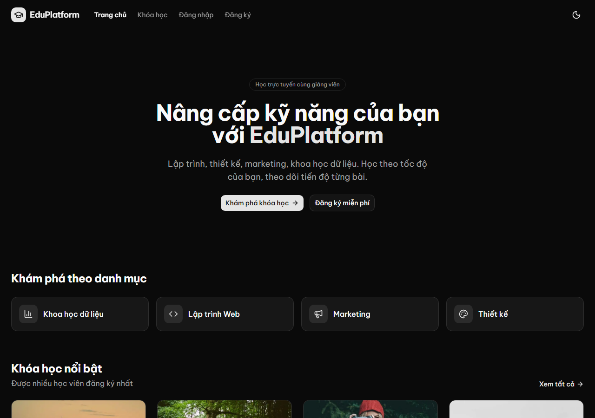
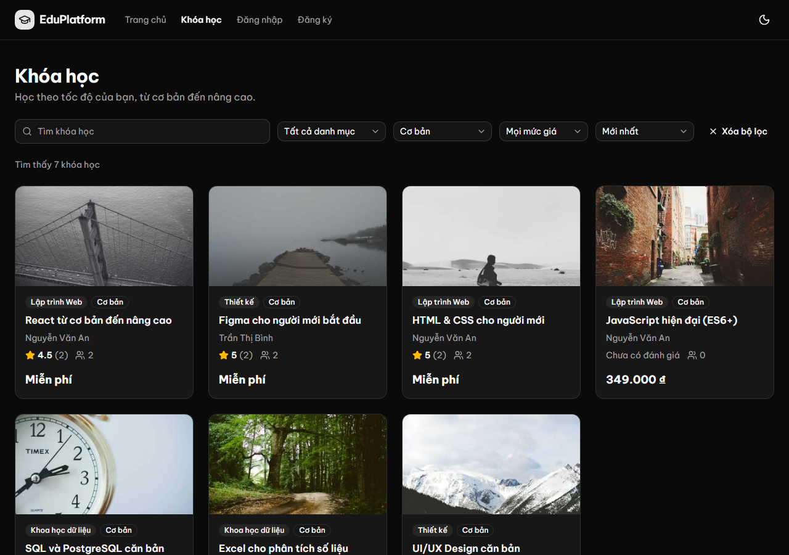
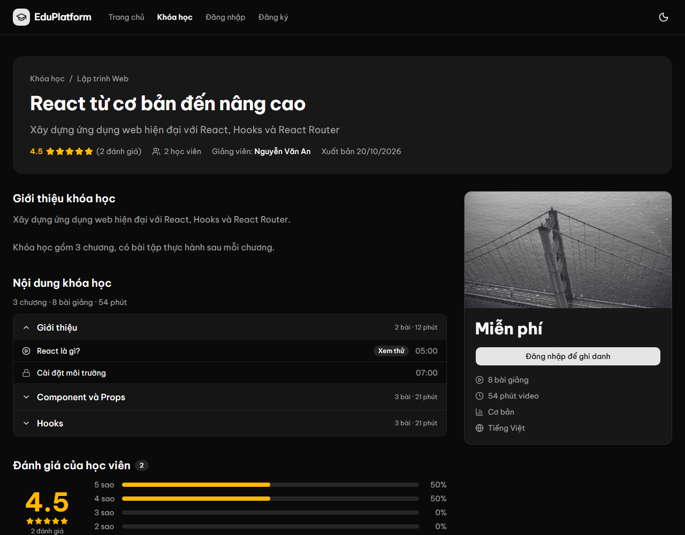

# Edu Platform

Nền tảng học trực tuyến kiểu Udemy, với 3 vai trò:

- **Học viên (Student)**: tìm khóa học, ghi danh, học, theo dõi tiến độ và đánh giá.
- **Giảng viên (Instructor)**: tạo khóa học, soạn chương và bài giảng, upload video, gửi duyệt, xem học viên của mình.
- **Admin**: duyệt / gỡ khóa học, quản lý người dùng, danh mục, role và quyền, xem thống kê.

## Demo

**Website: <https://edu-platform-8b8a.vercel.app>**

| Vai trò | Email | Mật khẩu |
|---|---|---|
| Học viên | `hocvien1@edu.local` | `Demo@1234` |
| Giảng viên | `giangvien1@edu.local` | `Demo@1234` |

Hoặc tự đăng ký tài khoản mới rồi ghi danh một khóa miễn phí.

> Backend chạy gói miễn phí của Render, **tự ngủ sau 15 phút không có ai dùng**: lần mở đầu tiên có thể mất khoảng 1 phút, các lần sau nhanh bình thường.

| Trang chủ | Danh sách khóa học (lọc trên URL) |
|---|---|
|  |  |



## Tình trạng

Frontend đang làm theo [lộ trình](docs/frontend-roadmap.md):

| Phần | Trạng thái |
|---|---|
| Xác thực: đăng ký, đăng nhập, đăng xuất, tự làm mới access token, chặn route theo role | ✅ |
| Trang công khai: danh sách (tìm kiếm, lọc, sắp xếp, phân trang trên URL), chi tiết khóa học, trang chủ | ✅ |
| Ghi danh khóa miễn phí | ✅ |
| Học viên: khóa học của tôi, trang học, đánh giá, hồ sơ | Đang làm |
| Giảng viên, admin | Chưa làm (backend đã có đủ API) |

**Phân công:** frontend do mình tự viết, dùng Claude để review và giải thích. Backend (Express, Prisma, hàng đợi, test, CI) được xây dựng cùng Claude để mình tập trung vào frontend; mình đọc hiểu, chạy thử và kiểm tra lại toàn bộ.

## Kiến trúc triển khai

```
Trình duyệt ──▶ Vercel (Next.js 16) ──▶ Render (Express API) ──▶ Neon (PostgreSQL)
                                              └──────────────▶ Render Key Value (Redis, hàng đợi BullMQ)
```

| Frontend | Công nghệ |
|---|---|
| Framework | Next.js 16 (App Router, Server Components, Cache Components, Partial Prerendering) + React 19 + TypeScript |
| Dữ liệu | Fetch wrapper riêng, TanStack Query cho thao tác ghi (mutation) |
| Form + validate | React Hook Form + Zod 4 (schema viết khớp với backend) |
| Giao diện | Tailwind CSS 4 + shadcn/ui, giao diện sáng / tối |
| Xác thực | JWT trong httpOnly cookie qua Route Handler, `proxy.ts` chặn route theo role, refresh token chống gọi trùng |

Thư mục:

```
Edu_Platform/
├── backend/                 API (Express + Prisma + PostgreSQL + Redis/BullMQ)
│   └── postman/             Postman collection cho toàn bộ API
├── frontend/                Next.js
├── docs/API.md              Tài liệu API cho frontend
└── .github/workflows/       CI: typecheck + lint + test cho backend
```

---

## Công nghệ

| Thành phần | Công nghệ | Ghi chú |
|---|---|---|
| Framework | Express 5 + TypeScript | Express 5 tự bắt lỗi của hàm `async` |
| ORM | Prisma 7 | driver adapter `@prisma/adapter-pg`; preview `partialIndexes` |
| Database | PostgreSQL 17 | Docker |
| Hàng đợi | BullMQ + Redis 7 | gửi email có retry, job định kỳ |
| Email | Nodemailer + Brevo API | dev: Mailpit (hộp thư giả, Docker); deploy: Brevo qua HTTP vì Render chặn SMTP |
| Upload | Multer | lưu trên ổ đĩa server, kiểm tra chữ ký file |
| Validate | Zod 4 | `.env`, body, params, query |
| Xác thực | JWT (`jsonwebtoken`) | access token 15 phút + refresh token 7 ngày, xoay vòng |
| Bảo mật | helmet, express-rate-limit, bcrypt | |
| Test | Vitest + Supertest | 44 test, database riêng |
| Lint | oxlint | |

---

## Chạy nhanh

Yêu cầu: Node.js 22 trở lên, Docker Desktop đang chạy.

```bash
cd backend

# 1. File môi trường (mở .env để đổi secret, mật khẩu admin)
cp .env.example .env

# 2. Cài package
npm install

# 3. Postgres + Redis + Mailpit
docker compose up -d

# 4. Tạo bảng + sinh Prisma Client
npx prisma migrate dev
npx prisma generate

# 5. Dữ liệu ban đầu
npm run seed               # 3 role + tài khoản admin (lấy từ .env)
npm run sync-permissions   # sinh permission từ route + gán quyền mặc định cho từng role
npm run seed:demo          # (tùy chọn) giảng viên, học viên, khóa học mẫu, mật khẩu Demo@1234

# 6. Chạy server (tự reload khi sửa code; worker gửi email chạy kèm)
npm run dev                # http://localhost:4000
```

Kiểm tra:

- `http://localhost:4000/courses`: danh sách khóa học (rỗng nếu chưa chạy `seed:demo`).
- `http://localhost:8025`: **Mailpit**, xem mọi email hệ thống gửi (chào mừng, mã OTP quên mật khẩu, khóa được duyệt...). Lúc dev không có email nào gửi ra ngoài thật.

### Các lệnh (chạy trong `backend/`)

| Lệnh | Việc |
|---|---|
| `npm run dev` | Server dev, tự reload. Chạy luôn worker nếu `RUN_WORKER=true` |
| `npm run worker` | Chạy worker (email, job định kỳ) thành process riêng |
| `npm test` | Chạy toàn bộ test (cần Postgres; tự tạo database `edu_platform_test`) |
| `npm run test:watch` | Test chế độ theo dõi |
| `npm run typecheck` | Kiểm tra kiểu cho cả `src/` và `tests/` |
| `npm run lint` | oxlint (`--type-aware`). Nếu `tsgolint.exe` không chạy được thì dùng `npx oxlint src tests` |
| `npm run format` | Prettier |
| `npm run seed` | Tạo role + admin (chỉ chạy được khi DB chưa có role) |
| `npm run seed:demo` | Dữ liệu mẫu (chạy lại được: chỉ tạo khóa / tài khoản chưa có) |
| `npm run sync-permissions` | Đồng bộ bảng Permission với route. **Thêm `-- --dry` để xem trước** |
| `npx prisma migrate dev --name <tên>` | Sau khi sửa `schema.prisma` |
| `npx prisma studio` | Xem / sửa dữ liệu bằng giao diện web |

---

## Biến môi trường (`backend/.env`)

| Biến | Ý nghĩa |
|---|---|
| `POSTGRES_USER`, `POSTGRES_PASSWORD`, `POSTGRES_DB`, `POSTGRES_PORT` | Cho Docker tạo Postgres |
| `DATABASE_URL` | Chuỗi kết nối Prisma, phải khớp với các biến `POSTGRES_*` |
| `PORT` | Cổng API, mặc định 4000 |
| `CORS_ORIGINS` | Frontend được phép gọi API, cách nhau bằng dấu phẩy. Mặc định `http://localhost:5173,http://localhost:3000` |
| `ACCESS_TOKEN_SECRET`, `REFRESH_TOKEN_SECRET` | Khóa ký JWT, mỗi cái một chuỗi ngẫu nhiên khác nhau |
| `ACCESS_TOKEN_EXPIRES_IN`, `REFRESH_TOKEN_EXPIRES_IN` | Ví dụ `15m`, `7d` |
| `ADMIN_NAME`, `ADMIN_EMAIL`, `ADMIN_PASSWORD`, `ADMIN_PHONE_NUMBER` | Tài khoản admin do `npm run seed` tạo |
| `REDIS_URL` | Redis cho BullMQ, mặc định `redis://localhost:6379` |
| `RUN_WORKER` | `true`: server chạy kèm worker (dev). `false`: chạy `npm run worker` riêng (deploy) |
| `SMTP_HOST`, `SMTP_PORT`, `SMTP_SECURE`, `SMTP_USER`, `SMTP_PASSWORD`, `MAIL_FROM` | Gửi email. Mặc định trỏ vào Mailpit |
| `FRONTEND_URL` | Địa chỉ frontend, dùng tạo link trong email |
| `PUBLIC_URL` | Địa chỉ công khai của API, dùng tạo link file upload |
| `UPLOAD_DIR`, `MAX_IMAGE_MB`, `MAX_VIDEO_MB` | Thư mục lưu file và giới hạn dung lượng |
| `RATE_LIMIT_ENABLED` | `false` để tắt giới hạn số request (khi test) |

Có file `.env` thì đọc, không có thì dùng biến môi trường sẵn có (CI, Docker). Thiếu hoặc sai biến thì server dừng ngay và in ra biến bị lỗi (Zod trong `src/config/env.ts`).

---

## Cấu trúc backend

```
backend/
├── docker-compose.yml         Postgres, Redis, Mailpit
├── prisma/
│   ├── schema.prisma          Định nghĩa bảng
│   └── migrations/            Lịch sử thay đổi DB (commit cùng code)
├── tests/                     Vitest + Supertest
└── src/
    ├── server.ts              Khởi động API (+ worker nếu RUN_WORKER=true)
    ├── worker.ts              Chạy worker thành process riêng
    ├── app.ts                 Middleware chung + router; danh sách protectedRouters
    ├── config/env.ts          Đọc và kiểm tra biến môi trường
    ├── constants/
    │   ├── role.ts            Tên 3 role hệ thống
    │   └── default-permissions.ts   Quyền mặc định của INSTRUCTOR / STUDENT
    ├── lib/                   Prisma Client, mailer (nodemailer)
    ├── emails/templates.ts    Nội dung email (HTML + text, có escape)
    ├── queues/                BullMQ: hàng đợi email, job định kỳ, worker
    ├── middleware/
    │   ├── auth.middleware.ts       requireAuth, optionalAuth, requireRole, requirePermission
    │   ├── validate.middleware.ts   validateBody / validateParams / validateQuery (Zod)
    │   ├── upload.middleware.ts     Multer: loại file, dung lượng, tên file
    │   ├── rate-limit.middleware.ts Giới hạn số request
    │   └── error.middleware.ts      404 + xử lý lỗi tập trung
    ├── utils/                 jwt, crypto (bcrypt, OTP), HttpError, pagination, file-signature...
    ├── scripts/               seed, seed-demo, sync-permissions
    └── modules/               Mỗi chức năng một thư mục
        └── <module>/
            ├── <module>.schema.ts      Zod: dữ liệu hợp lệ
            ├── <module>.service.ts     Logic + Prisma
            ├── <module>.controller.ts  Đọc req, gọi service, trả res
            └── <module>.route.ts       Khai báo URL + middleware
```

Module: `auth`, `profile`, `user`, `permission`, `role`, `category`, `course`, `section`, `lecture`, `enrollment`, `review`, `stats`, `upload`.

### Một request đi qua những đâu

```
helmet → cors → rate limit → express.json → router (theo prefix) → requireAuth → requirePermission → validate... → controller → service → Prisma
                    │                                                    │               │                  │
                   429                                                  401             403                422     lỗi nào cũng về errorHandler
```

---

## Các khái niệm chính

### Xác thực (JWT)

- **Access token**: 15 phút, không lưu DB. `requireAuth` chỉ kiểm tra chữ ký.
- **Refresh token**: 7 ngày, **lưu DB**, mỗi token dùng **một lần**. Mỗi lần refresh thì xóa token cũ và cấp cặp mới, trong cùng một transaction.
- Logout = xóa refresh token khỏi DB. Đổi / đặt lại mật khẩu hoặc bị khóa = xóa **mọi** refresh token của user.
- **Quên mật khẩu**: OTP 6 số qua email, lưu dạng hash, hết hạn 10 phút, sai 5 lần thì hủy, dùng một lần.

### Phân quyền động (RBAC)

```
User ──1 role──> Role ──nhiều──> Permission (method + path, ví dụ "PUT /courses/:courseId")
```

- Route nào cần quyền thì gắn `requireAuth, requirePermission` **ở từng route** (`req.route` chỉ có ở mức route).
- `npm run sync-permissions` đọc các route có `requirePermission` trong `protectedRouters` (`app.ts`), rồi tạo hoặc xóa mềm permission cho khớp, gán **tất cả** cho ADMIN và gán quyền trong `default-permissions.ts` cho INSTRUCTOR / STUDENT. Lệnh này chỉ **thêm** quyền, không gỡ quyền admin đã gán bằng tay.
- Mỗi request, `requirePermission` đọc DB nên đổi quyền hay khóa tài khoản có hiệu lực **ngay**.
- Quyền theo **chủ sở hữu** (giảng viên chỉ sửa khóa của mình...) kiểm tra trong service.

**Thêm một API mới cần phân quyền:**

1. Khai báo route kèm `requireAuth, requirePermission`.
2. Router mới thì thêm vào `protectedRouters` trong `app.ts`.
3. Nếu INSTRUCTOR / STUDENT cần quyền này, thêm `"METHOD /path"` vào `src/constants/default-permissions.ts`.
4. `npm run sync-permissions -- --dry` → kiểm tra "Sẽ xoá" **rỗng** → `npm run sync-permissions`.

### Vòng đời khóa học

```
DRAFT ──gửi duyệt──> PENDING ──admin duyệt──> PUBLISHED (hiện công khai, ghi danh được)
  ▲                     │                        │
  └──── REJECTED <──────┴── admin từ chối ────────┘ admin gỡ (kèm lý do)
```

- Sửa khóa / chương / bài: khi `DRAFT`, `REJECTED` hoặc `PUBLISHED` (có hiệu lực ngay). Không sửa khi `PENDING`.
- Xóa khóa: chỉ khi `DRAFT` / `REJECTED`. Khóa đã xuất bản luôn phải còn ít nhất 1 bài.
- Đổi trạng thái dùng `updateMany` kèm điều kiện trạng thái cũ, nên 2 admin bấm duyệt cùng lúc thì chỉ một người thành công.
- Duyệt / từ chối / gỡ đều gửi email cho giảng viên.

### Xử lý nền (BullMQ)

- Request chỉ **đẩy job vào hàng đợi** (Redis), trả về ngay. Worker xử lý sau, lỗi thì **tự thử lại** (5 lần, đợi tăng dần 10s → 80s).
- Email "có cũng được" (chào mừng, thông báo duyệt): hàng đợi lỗi thì chỉ ghi log, không làm hỏng request. Email OTP: lỗi thì trả 503.
- Job định kỳ 3h sáng mỗi ngày: xóa refresh token và mã OTP đã hết hạn.

### Quy ước dữ liệu

- **Xóa mềm** (`deletedAt`) cho user, role, permission, category, course, section, lecture: mọi query đọc đều lọc `deletedAt: null`. Riêng đánh giá thì xóa thật.
- **Unique chỉ tính dòng chưa xóa** (partial unique index): tên role, tên danh mục, cặp method + path của permission. Xóa mềm xong có thể tạo lại cùng tên; 2 request tạo trùng cùng lúc thì DB chặn (409).
- Giá tiền là **VND số nguyên**. Thời lượng tính bằng **giây**.
- Response: `{ message, data }`. Danh sách: `{ message, data, totalItems, page, limit, totalPages }`. Lỗi: `{ message, errors? }`.

Chi tiết từng API: **[docs/API.md](docs/API.md)**. Gọi thử: import `backend/postman/edu-platform.postman_collection.json` vào Postman.

---

## Test

```bash
cd backend
npm test
```

- Chạy trên database **riêng** `edu_platform_test` (cùng server Postgres): chưa có thì tự tạo, rồi `migrate deploy`, seed nếu trống, sync quyền. **Không xóa dữ liệu nào**; test dùng email và tên ngẫu nhiên nên chạy lại bao nhiêu lần cũng được. Muốn dọn sạch thì tự xóa database `edu_platform_test`, lần sau sẽ tự tạo lại.
- Tên database test bắt buộc kết thúc bằng `_test` (chốt an toàn). Đổi bằng biến `TEST_DATABASE_URL`.
- Hàng đợi email được giả lập (không cần Redis), test đọc được email "đã gửi" để lấy mã OTP.
- `tests/unit/`: hàm thuần. Các file còn lại: gọi API thật qua Supertest (auth, phân quyền, quản lý user, hồ sơ, toàn bộ vòng đời khóa học, upload).
- CI (`.github/workflows/backend.yml`) chạy typecheck, lint và test mỗi lần push có sửa `backend/`.

---

## Triển khai (deploy)

Đang chạy trên gói miễn phí: Vercel (frontend), Render (backend + Key Value), Neon (PostgreSQL). Cả Vercel và Render tự deploy lại khi push lên nhánh `main`.

**Database (Neon):** dùng chuỗi kết nối **trực tiếp** (tên host không có `-pooler`, kết nối qua pooler làm `prisma migrate deploy` bị treo). Tạo bảng và dữ liệu ban đầu từ máy local:

```powershell
cd backend
$env:DATABASE_URL="<chuỗi kết nối Neon>"; $env:ADMIN_PASSWORD="<mật khẩu admin>"
npx prisma migrate deploy
npm run seed
npm run sync-permissions   # bắt buộc, thiếu thì mọi API cần quyền trả 403
npm run seed:demo
Remove-Item Env:DATABASE_URL; Remove-Item Env:ADMIN_PASSWORD
```

**Backend (Render Web Service):** Root Directory `backend`, region Singapore

| | |
|---|---|
| Build Command | `npm ci && npx prisma generate && npm run build` |
| Start Command | `npx prisma migrate deploy && npm start` |
| Biến môi trường | Như `.env.example`, thêm `TRUST_PROXY=1`, `RUN_WORKER=true`, `REDIS_URL` là Internal URL của Key Value (maxmemory policy `noeviction`), `CORS_ORIGINS` có domain Vercel |

**Frontend (Vercel):** Root Directory `frontend`, function region Singapore, biến `NEXT_PUBLIC_API_END_POINT` (link Render, không có `/` cuối) và `NEXT_PUBLIC_URL`. Biến `NEXT_PUBLIC_*` gắn vào lúc build: đổi xong phải Redeploy.

**Giới hạn của gói miễn phí:** Render ngủ sau 15 phút, ổ đĩa bị xóa khi khởi động lại (upload chưa dùng được, cần chuyển sang Cloudinary), chặn cổng SMTP (email cần dịch vụ gửi qua HTTP API).

---

## Lỗi thường gặp

| Triệu chứng | Nguyên nhân / cách sửa |
|---|---|
| `port is already allocated` khi `docker compose up` | Một Postgres / Redis khác đang dùng cổng. Đổi `POSTGRES_PORT` (và port trong `DATABASE_URL`) hoặc `REDIS_PORT` |
| `Can't reach database server` | Docker Desktop chưa bật, hoặc `DATABASE_URL` không khớp `POSTGRES_*` |
| `Các giá trị khai báo trong file .env không hợp lệ` | Thiếu biến hoặc sai định dạng, xem dòng lỗi in ra |
| `Cannot find module '../generated/prisma/client'` | Chưa chạy `npx prisma generate` |
| `Property 'xxx' does not exist on type 'PrismaClient'` | Sửa `schema.prisma` mà chưa `migrate dev` / `generate` |
| API trả 500, log có `Unknown argument 'createById'` | Tên field sai so với cột (ví dụ thiếu chữ `d`: `createdById`). TypeScript không bắt được lỗi này với `data` của Prisma |
| Mọi request của giảng viên / học viên đều 403 | Chưa chạy `npm run sync-permissions` sau khi thêm route |
| `sync-permissions` báo "Sẽ xoá" nhiều permission đang dùng | **Dừng lại**: thường do một route bị gỡ `requirePermission` hoặc router bị bỏ khỏi `protectedRouters` |
| Không thấy email | Mở `http://localhost:8025`. Kiểm tra `docker compose ps` có `edu_mailpit` và `edu_redis`, log server có dòng `Worker đang chạy` |
| Đăng ký chậm thêm ~3 giây | Redis không chạy: hàng đợi email đợi 3 giây rồi bỏ qua. Bật lại `docker compose up -d` |
| Quên mật khẩu trả 503 | Redis không chạy, không gửi được email OTP |
| 429 khi đăng nhập | Sai quá 10 lần trong 15 phút (theo IP). Đợi theo header `Retry-After`, hoặc khởi động lại server lúc dev |
| `npm run lint` lỗi `spawnSync ... tsgolint.exe UNKNOWN` | Lỗi công cụ trên Windows, dùng `npx oxlint src tests` |
| `prisma migrate dev` báo "non-interactive" | Đang chạy trong môi trường không tương tác và có cảnh báo cần xác nhận: chạy lệnh trong terminal thường |
| Trình duyệt báo lỗi CORS | Thêm địa chỉ frontend vào `CORS_ORIGINS` trong `.env` rồi khởi động lại server |

---

## Tiến độ

- [x] Xác thực: đăng ký, đăng nhập, `me`, refresh token xoay vòng, logout, quên mật khẩu (OTP)
- [x] Hồ sơ, đổi mật khẩu; admin quản lý user (khóa, đổi role)
- [x] Phân quyền động: Permission, Role, sync từ route, quyền mặc định
- [x] Danh mục
- [x] Khóa học: giảng viên quản lý, luồng duyệt, gỡ khóa, trang công khai có tìm kiếm / lọc / sắp xếp
- [x] Chương và bài giảng, bài xem thử, đổi thứ tự, chuyển bài giữa các chương
- [x] Ghi danh (khóa miễn phí), tiến độ học
- [x] Đánh giá, điểm trung bình
- [x] Thống kê cho admin và giảng viên
- [x] Upload ảnh / video
- [x] Email qua hàng đợi BullMQ (retry), job dọn dữ liệu hết hạn
- [x] Helmet, rate limit, log request, partial unique index
- [x] Test tự động (Vitest + Supertest), CI GitHub Actions
- [ ] Thanh toán (khóa có phí đang trả 402)
- [ ] Upload lên cloud (S3 / Cloudinary) thay vì ổ đĩa server
- [ ] Xác thực email khi đăng ký
- [ ] Hỏi đáp theo bài giảng, thông báo
- [x] Deploy (Vercel + Render + Neon)

## Ghi nguồn thiết kế

Giao diện các trang công khai dựng theo bản thiết kế **EduPress – Free Education Template (Online Courses / E-Learning)** của **ThimPress** trên Figma Community. Hình minh họa ở trang chủ (ảnh học viên ở banner đầu trang, hình minh họa khối "Grow your skills", icon danh mục) lấy từ chính file thiết kế đó.

- Tên thương hiệu, logo, nội dung và dữ liệu là của EduPlatform; không dùng logo / tên EduPress, ThimPress.
- Hai banner quảng cáo sản phẩm của ThimPress trong bản thiết kế được giữ bố cục nhưng thay nội dung (thanh toán, mời làm giảng viên) và không dùng logo của hãng nào.
- Ảnh chụp người thật trong file thiết kế có thể có giấy phép riêng của nhà cung cấp ảnh; nếu dùng cho mục đích thương mại cần kiểm tra lại hoặc thay ảnh.
