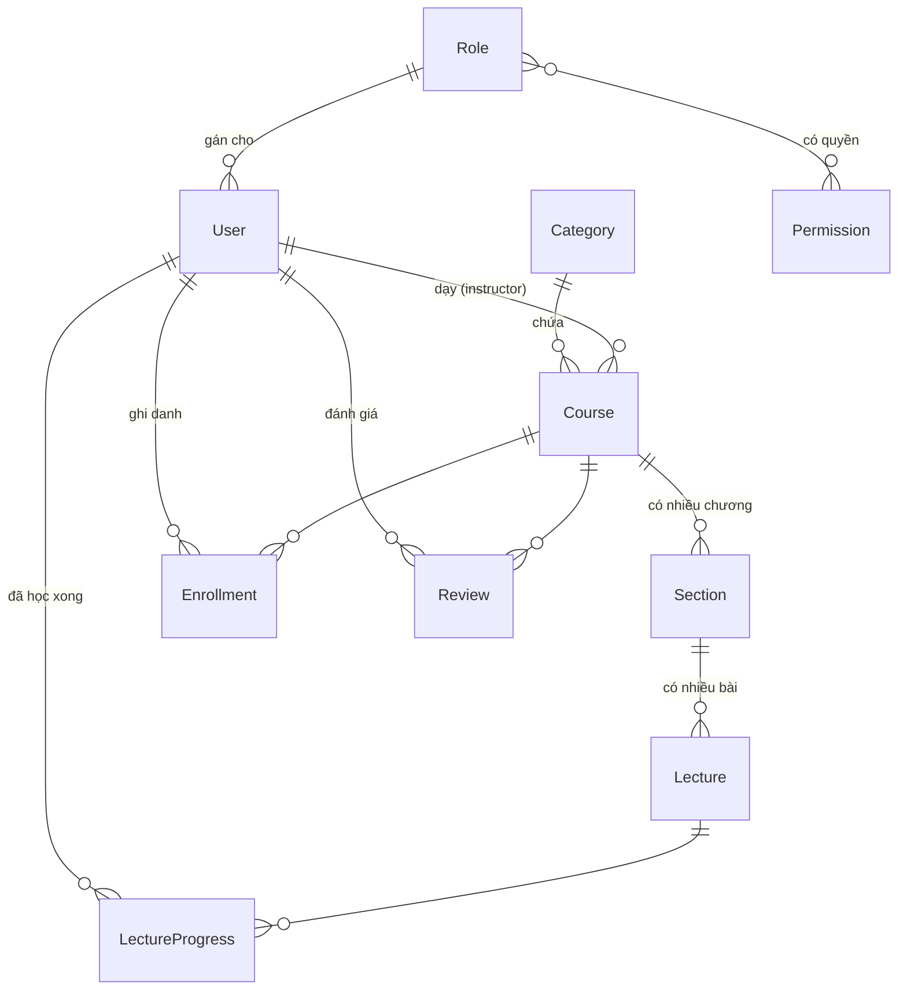
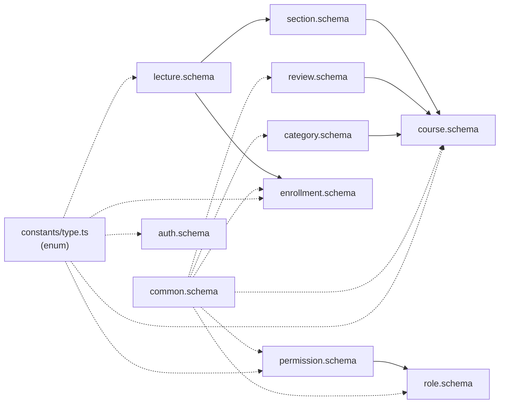
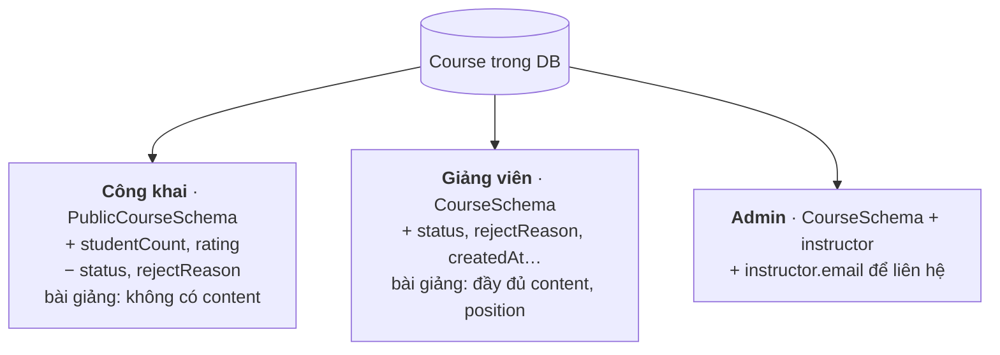
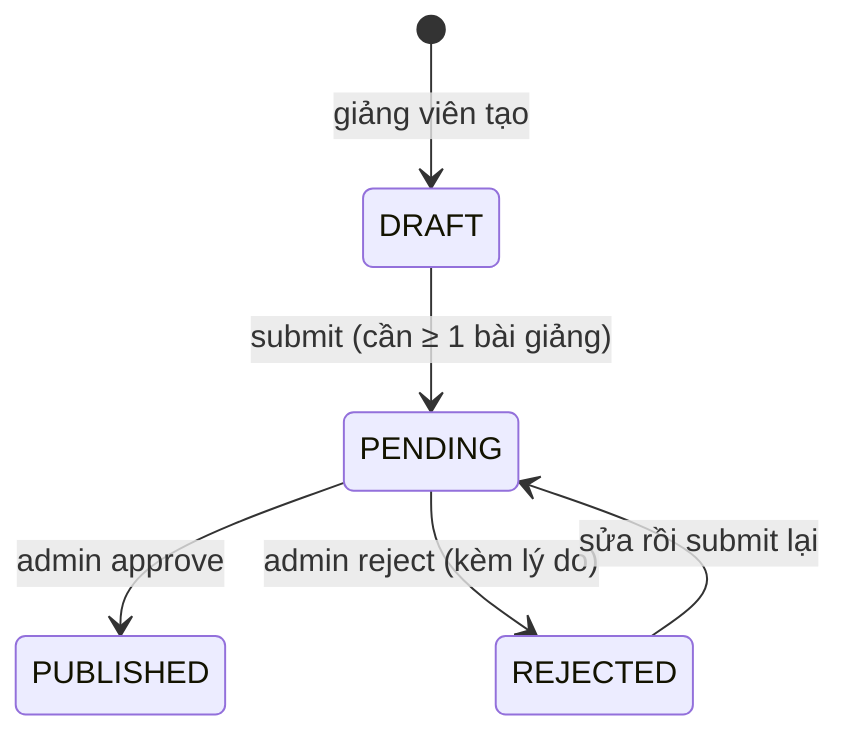

# Đọc hiểu schema frontend

Giải thích từng trường trong `frontend/src/schemaValidations/` và vì sao nó có kiểu như vậy. Đọc kèm [API.md](API.md) (API nhận gì, trả gì).

> Xem sơ đồ: mở file này trong VS Code rồi bấm `Ctrl+Shift+V`. Sơ đồ Mermaid cần extension **Markdown Preview Mermaid Support** (`bierner.markdown-mermaid`); trên GitHub thì tự hiện.

## Mục lục

1. [Quy ước đặt tên](#1-quy-ước-đặt-tên)
2. [Zod: các hàm hay gặp](#2-zod-các-hàm-hay-gặp)
3. [Sơ đồ quan hệ](#3-sơ-đồ-quan-hệ)
4. [common.schema.ts](#4-commonschemats)
5. [auth.schema.ts](#5-authschemats)
6. [category.schema.ts](#6-categoryschemats)
7. [course.schema.ts](#7-courseschemats)
8. [section.schema.ts và lecture.schema.ts](#8-sectionschemats-và-lectureschemats)
9. [enrollment.schema.ts](#9-enrollmentschemats)
10. [review.schema.ts](#10-reviewschemats)
11. [role.schema.ts và permission.schema.ts](#11-roleschemats-và-permissionschemats)
12. [Những chỗ dễ nhầm](#12-những-chỗ-dễ-nhầm)

---

## 1. Quy ước đặt tên

Hậu tố cho biết schema dùng vào việc gì:

| Hậu tố | Nghĩa | Ví dụ |
|---|---|---|
| `...Schema` | Một đối tượng dữ liệu, dùng lại bên trong các Res | `CourseSchema`, `LectureSchema` |
| `...Body` | Body gửi lên (POST / PUT) | `CreateCourseBody` |
| `...Query` | Query trên URL (`?page=1&limit=10`) | `GetCoursesQuery` |
| `...Res` | Response trả về **một** đối tượng | `CourseRes` |
| `...ListRes` | Response trả về **danh sách có phân trang** | `PublicCourseListRes` |

Mỗi schema có một type cùng tên thêm `Type`: `CourseRes` → `CourseResType`. Schema dùng để **kiểm tra lúc chạy**, type dùng để **gợi ý code lúc viết**.

`auth.schema.ts` còn giữ tên kiểu cũ (`LoginBodySchema`, `LoginBodyRes`), chưa đổi theo quy ước này.

**Body / Query copy từ backend, Res tự viết.** Backend Express chỉ kiểm tra dữ liệu gửi lên nên chỉ có Body / Query / Params. Res được viết theo response thật và đã kiểm tra bằng cách gọi API với từng vai trò.

---

## 2. Zod: các hàm hay gặp

| Viết | Nghĩa | Ví dụ giá trị hợp lệ |
|---|---|---|
| `z.string()` | Chuỗi | `"abc"`, `""` |
| `z.number()` | Số | `15`, `4.5` |
| `z.boolean()` | true / false | `true` |
| `.nullable()` | Được phép là `null` | `null`, `"abc"` |
| `.optional()` | Được phép **không có** field này | (không gửi) |
| `.default(x)` | Không có thì lấy `x` | thiếu `page` → `1` |
| `z.coerce.number()` | Đổi sang số trước khi kiểm tra (dùng cho query vì URL luôn là chuỗi) | `"2"` → `2` |
| `.trim()` | Bỏ khoảng trắng đầu cuối | `"  abc "` → `"abc"` |
| `.min(1, 'msg')` / `.max(n)` | Độ dài chuỗi hoặc giá trị số | |
| `.int()` / `.positive()` | Số nguyên / số dương | |
| `z.enum(X)` | Chỉ nhận các giá trị trong `X` | `'DRAFT'` |
| `z.array(S)` | Mảng các phần tử kiểu `S` | `[{...}, {...}]` |
| `z.record(z.string(), z.number())` | Object có key tùy ý, value là số | `{ "1": 0, "5": 3 }` |
| `.strict()` | Có field lạ thì báo lỗi | gửi thêm `abc` → lỗi |
| `.extend({...})` | Lấy schema cũ, **thêm** field → schema mới | |
| `.pick({ a: true })` | Lấy schema cũ, **chỉ giữ** vài field | |
| `.refine(fn, {...})` | Luật tự viết, kiểm tra nhiều field cùng lúc | mật khẩu xác nhận phải trùng |
| `.transform(fn)` | Biến đổi giá trị sau khi kiểm tra | `[3,1,3]` → `[3,1]` |

**`nullable` khác `optional`:**
- `avatar: z.string().nullable()` → field **luôn có**, giá trị là chuỗi hoặc `null`.
- `subtitle: z.string().optional()` → field **có thể không xuất hiện**.

Res dùng `nullable` (backend luôn trả đủ field), Body dùng `optional` (người dùng không bắt buộc nhập).

---

## 3. Sơ đồ quan hệ

### Dữ liệu trong database



`||--o{` đọc là **một – nhiều**: một Course có nhiều Section. `}o--o{` là **nhiều – nhiều**: một Role có nhiều Permission, một Permission thuộc nhiều Role.

### File schema nào import file nào



Mũi tên đi từ file **được import** tới file **import nó**. Tầng nhỏ (lecture) không import tầng lớn (course): import ngược lại sẽ thành import vòng tròn và schema bị `undefined` khi chạy.

### Một khóa học trông khác nhau theo người xem



---

## 4. common.schema.ts

Phần dùng chung cho mọi module.

### `MessageRes`: API chỉ trả thông báo (xóa, đăng xuất)

```json
{ "message": "Xóa khóa học thành công" }
```

### `PaginationQuery`: query phân trang

| Trường | Kiểu | Ý nghĩa |
|---|---|---|
| `page` | số nguyên ≥ 1, mặc định `1` | Trang thứ mấy |
| `limit` | số nguyên 1–100, mặc định `10` | Bao nhiêu phần tử mỗi trang |

### `PaginationRes`: phần phân trang có trong mọi `...ListRes`

| Trường | Ý nghĩa | Ví dụ |
|---|---|---|
| `totalItems` | Tổng số phần tử (mọi trang) | `25` |
| `page` | Trang hiện tại | `1` |
| `limit` | Số phần tử mỗi trang | `10` |
| `totalPages` | Tổng số trang = ⌈totalItems / limit⌉ | `3` |

Một `ListRes` = `PaginationRes` + `data` (mảng) + `message`:

```json
{ "message": "...", "data": [ ... ], "totalItems": 25, "page": 1, "limit": 10, "totalPages": 3 }
```

---

## 5. auth.schema.ts

| Schema | API |
|---|---|
| `RegisterBodySchema` → `RegisterBodyRes` | `POST /auth/register` |
| `LoginBodySchema` → `LoginBodyRes` | `POST /auth/login` |
| `RefreshTokenBodySchema` → `RefreshTokenBodyRes` | `POST /auth/refresh-token` |
| `LogoutBodySchema` → `MessageRes` | `POST /auth/logout` |
| `MeRes` | `GET /auth/me` |

### Body đăng ký

| Trường | Luật |
|---|---|
| `email` | Đúng định dạng email |
| `password` | 8–100 ký tự |
| `confirmPassword` | Phải trùng `password` (kiểm tra bằng `.refine`, lỗi gắn vào ô `confirmPassword`) |
| `name` | 1–100 ký tự sau khi bỏ khoảng trắng |
| `phoneNumber` | 9–15 ký tự |

### Response đăng nhập / đăng ký (giống hệt nhau)

| Trường | Ý nghĩa |
|---|---|
| `data.accessToken` | Gửi kèm mọi request cần đăng nhập: header `Authorization: Bearer <token>`. Hết hạn sau **15 phút** |
| `data.refreshToken` | Dùng để xin cặp token mới. Hết hạn sau **7 ngày**, **mỗi token chỉ dùng được 1 lần** |
| `data.account.id` / `name` / `email` | Thông tin cơ bản để hiện trên header |
| `data.account.role` | Chuỗi `ADMIN` / `INSTRUCTOR` / `STUDENT` → điều hướng theo vai trò |

### `MeRes`: thông tin đầy đủ của người đang đăng nhập

Dùng khi **tải lại trang** (lúc đó không còn response của login).

| Trường | Kiểu | Ý nghĩa |
|---|---|---|
| `id`, `email`, `name`, `phoneNumber` | | |
| `avatar` | chuỗi hoặc `null` | Chưa có ảnh thì `null` → hiện ảnh mặc định |
| `status` | `ACTIVE` / `INACTIVE` / `BLOCKED` | `BLOCKED` thì không đăng nhập được |
| `roleId` | số | |
| `role` | **object** `{ id, name }` | Khác login: ở login `role` là chuỗi |
| `createdAt`, `updatedAt` | chuỗi ngày ISO | |

---

## 6. category.schema.ts

### `CategorySchema`

| Trường | Kiểu | Ý nghĩa |
|---|---|---|
| `id` | số | |
| `name` | chuỗi | Tên danh mục, không trùng (không phân biệt hoa thường) |
| `description` | chuỗi | Không có mô tả thì là `""`, **không phải** `null` |

| Schema | API | Ai |
|---|---|---|
| `GetCategoriesQuery` → `CategoryListRes` | `GET /categories` | Công khai |
| `CategoryRes` | `GET /categories/:id` | Công khai |
| `CreateCategoryBody` → `CategoryRes` | `POST /categories` | Admin |
| `UpdateCategoryBody` → `CategoryRes` | `PUT /categories/:id` | Admin |
| `MessageRes` | `DELETE /categories/:id` | Admin (409 nếu còn khóa học) |

---

## 7. course.schema.ts

File lớn nhất vì **một khóa học có 3 cách nhìn** (xem sơ đồ ở mục 3).

### `PublicCourseSchema`: thẻ khóa học ở trang chủ / tìm kiếm

| Trường | Kiểu | Ý nghĩa |
|---|---|---|
| `id`, `title` | | |
| `subtitle` | chuỗi | Mô tả ngắn, trống là `""` |
| `thumbnail` | chuỗi hoặc `null` | URL ảnh bìa |
| `price` | số nguyên | **VND**. `0` = miễn phí |
| `level` | `BEGINNER` / `INTERMEDIATE` / `ADVANCED` / `ALL_LEVELS` | Trình độ |
| `language` | chuỗi | Mã ngôn ngữ, mặc định `"vi"` |
| `publishedAt` | chuỗi ngày ISO | Ngày được duyệt xuất bản |
| `category` | `{ id, name }` | |
| `instructor` | `{ id, name, avatar }` | Giảng viên (không có email) |
| `studentCount` | số | Số học viên đã ghi danh |
| `rating` | `{ averageRating, totalReviews }` | Điểm trung bình (1 chữ số thập phân, chưa có thì `0`) |

### `PublicCourseDetailRes`: trang chi tiết (`GET /courses/:id`)

`PublicCourseSchema` cộng thêm:

| Trường | Ý nghĩa |
|---|---|
| `description` | Mô tả chi tiết |
| `sections` | Mục lục: mảng `PublicSectionSchema` (mục 8) |
| `totalLectures` | Tổng số bài |
| `totalDurationSec` | Tổng thời lượng, **tính bằng giây** → tự đổi ra "2 giờ 15 phút" |
| `rating` | Thêm `distribution`: số lượt theo từng mức sao |
| `isEnrolled` | `null` = khách chưa đăng nhập · `true` = đã ghi danh → nút **Vào học** · `false` → nút **Ghi danh** |

### `CourseSchema`: khóa học đầy đủ (giảng viên / admin)

| Trường | Kiểu | Ý nghĩa |
|---|---|---|
| `id`, `title`, `subtitle`, `description`, `thumbnail`, `price`, `level`, `language` | | Như trên |
| `status` | `DRAFT` / `PENDING` / `PUBLISHED` / `REJECTED` | Trạng thái duyệt (sơ đồ bên dưới) |
| `rejectReason` | chuỗi hoặc `null` | Lý do admin từ chối, chỉ có khi `REJECTED` |
| `publishedAt` | chuỗi ngày hoặc `null` | `null` cho tới khi được duyệt |
| `instructorId`, `categoryId` | số | |
| `createdAt`, `updatedAt` | chuỗi ngày ISO | |
| `category` | `{ id, name }` | |



Chỉ sửa / xóa được khóa ở `DRAFT` hoặc `REJECTED`. Chỉ duyệt được khóa `PENDING`.

### Các schema theo API

| Schema | API | Ai |
|---|---|---|
| `GetCoursesQuery` → `PublicCourseListRes` | `GET /courses` | Công khai |
| `PublicCourseDetailRes` | `GET /courses/:id` | Công khai (gửi token thì có `isEnrolled`) |
| `GetMyCoursesQuery` → `MyCourseListRes` | `GET /courses/mine` | Giảng viên |
| `MyCourseDetailRes` | `GET /courses/mine/:id` | Giảng viên (kèm mục lục đầy đủ) |
| `CreateCourseBody` → `CourseRes` | `POST /courses` | Giảng viên |
| `UpdateCourseBody` → `CourseRes` | `PUT /courses/:id` | Giảng viên |
| `CourseRes` | `POST /courses/:id/submit` | Giảng viên |
| `MessageRes` | `DELETE /courses/:id` | Giảng viên |
| `GetPendingCoursesQuery` → `PendingCourseListRes` | `GET /courses/pending` | Admin |
| `AdminCourseDetailRes` | `GET /courses/admin/:id` | Admin |
| `CourseRes` | `POST /courses/:id/approve` | Admin |
| `RejectCourseBody` → `CourseRes` | `POST /courses/:id/reject` | Admin |

### Query lọc khóa học (`GetCoursesQuery`)

| Trường | Giá trị | Ý nghĩa |
|---|---|---|
| `search` | chuỗi ≤ 200 | Tìm trong tên và mô tả ngắn |
| `categoryId` | số | Lọc theo danh mục |
| `level` | như `level` ở trên | Lọc theo trình độ |
| `price` | `free` / `paid` | Miễn phí / có phí |
| `sort` | `newest` (mặc định) / `popular` / `price_asc` / `price_desc` | Mới nhất / nhiều học viên / giá tăng / giá giảm |
| `page`, `limit` | | Từ `PaginationQuery` (nhờ `.extend`) |

---

## 8. section.schema.ts và lecture.schema.ts

Khóa học có 3 tầng: **Course → Section (chương) → Lecture (bài giảng)**.

### `LectureSchema`: bài giảng đầy đủ

| Trường | Kiểu | Ý nghĩa |
|---|---|---|
| `id`, `title` | | |
| `videoUrl` | chuỗi hoặc `null` | Link video |
| `content` | chuỗi | Ghi chú / nội dung bài, trống là `""` |
| `durationSec` | số | Thời lượng **tính bằng giây** (0–86400) |
| `isPreview` | true / false | `true` = bài xem thử, ai cũng xem được |
| `position` | số | Thứ tự trong chương, **số nhỏ đứng trước** (bắt đầu từ 0) |
| `sectionId` | số | Thuộc chương nào |
| `createdAt`, `updatedAt` | chuỗi ngày ISO | |

### Ba phiên bản bài giảng

| Schema | Có những trường | Dùng ở |
|---|---|---|
| `LectureSchema` | Tất cả | Giảng viên soạn bài, `GET /lectures/:id` |
| `PublicLectureSchema` (`.pick`) | `id`, `title`, `durationSec`, `isPreview`, `videoUrl` | Mục lục công khai. `videoUrl` là `null` nếu không phải bài xem thử, `content` không có |
| `LearningLectureSchema` (mục 9) | `id`, `title`, `durationSec`, `isPreview`, **`completed`** | Mục lục trang học, `completed` hiện dấu ✓ |

### `SectionSchema`: chương

| Trường | Ý nghĩa |
|---|---|
| `id`, `title` | |
| `position` | Thứ tự trong khóa, số nhỏ đứng trước |
| `courseId` | Thuộc khóa nào |
| `createdAt`, `updatedAt` | |

`SectionWithLecturesSchema` = `SectionSchema` + `lectures: LectureSchema[]`. `PublicSectionSchema` chỉ có `id`, `title`, `lectures: PublicLectureSchema[]`.

### Các schema theo API

| Schema | API | Ghi chú |
|---|---|---|
| `CreateSectionBody` → `SectionRes` | `POST /sections` | Chương mới luôn thêm vào **cuối** |
| `UpdateSectionBody` → `SectionRes` | `PUT /sections/:id` | Gửi `position` mới để đổi thứ tự |
| `MessageRes` | `DELETE /sections/:id` | Xóa luôn các bài trong chương |
| `CreateLectureBody` → `LectureRes` | `POST /lectures` | |
| `UpdateLectureBody` → `LectureRes` | `PUT /lectures/:id` | Không đổi được chương |
| `MessageRes` | `DELETE /lectures/:id` | |
| `LectureDetailRes` | `GET /lectures/:id` | Kèm `section.course` để hiện "Khóa học › Chương › Bài" |
| `LectureCompletionRes` | `POST` / `DELETE /lectures/:id/complete` | `{ lectureId, completed }` |

Chỉ sửa được chương / bài khi khóa đang `DRAFT` hoặc `REJECTED`.

---

## 9. enrollment.schema.ts

### `ProgressSchema`: tiến độ học

| Trường | Ý nghĩa |
|---|---|
| `totalLectures` | Tổng số bài của khóa |
| `completedLectures` | Số bài đã đánh dấu xong |
| `percent` | 0–100, đã làm tròn → vẽ thanh tiến độ |

### Các schema theo API

| Schema | API | Ghi chú |
|---|---|---|
| `CreateEnrollmentBody` → `EnrollmentRes` | `POST /enrollments` | 409 nếu đã ghi danh, **402** nếu khóa có phí (chưa có thanh toán) |
| `GetMyEnrollmentsQuery` → `MyEnrollmentListRes` | `GET /enrollments/mine` | Trang "Khóa học của tôi" |
| `LearningRes` | `GET /enrollments/mine/:courseId` | Trang học: mục lục + tiến độ |

**`MyEnrollmentSchema`** (một phần tử của "Khóa học của tôi"):

| Trường | Ý nghĩa |
|---|---|
| `enrolledAt` | Ngày ghi danh |
| `course` | `{ id, title, subtitle, thumbnail, level, instructor: { id, name } }` |
| `progress` | `ProgressSchema` |

**`LearningRes`**: `enrolledAt`, `progress`, và `course` có `sections[].lectures[]` dạng `LearningLectureSchema`. Không có `videoUrl` / `content`: bấm vào bài nào thì gọi `GET /lectures/:id` để lấy nội dung bài đó.

---

## 10. review.schema.ts

### `RatingSchema` và `RatingSummarySchema`

| Trường | Ý nghĩa |
|---|---|
| `averageRating` | Điểm trung bình, 1 chữ số thập phân, chưa có đánh giá thì `0` |
| `totalReviews` | Số lượt đánh giá |
| `distribution` (chỉ `RatingSummarySchema`) | Số lượt theo mức sao: `{ "1": 0, "2": 0, "3": 0, "4": 1, "5": 1 }` → vẽ thanh 5 mức sao. Key là **chuỗi** |

`course.schema` import 2 schema này: danh sách khóa dùng `RatingSchema`, trang chi tiết dùng `RatingSummarySchema`.

### `ReviewSchema`

| Trường | Ý nghĩa |
|---|---|
| `id` | |
| `rating` | 1–5 sao |
| `comment` | Không viết thì `""` |
| `userId`, `courseId` | |
| `createdAt`, `updatedAt` | |
| `user` | `{ id, name, avatar }`: người viết đánh giá |

### Các schema theo API

| Schema | API | Ghi chú |
|---|---|---|
| `GetReviewsQuery` → `ReviewListRes` | `GET /reviews?courseId=…` | `courseId` **bắt buộc**. Có thêm `summary` ngoài `data` |
| `MyReviewRes` | `GET /reviews/mine/:courseId` | `data: null` = chưa đánh giá → form **Viết**; có dữ liệu → form **Sửa** |
| `CreateReviewBody` → `ReviewRes` | `POST /reviews` | Phải ghi danh trước (403), mỗi khóa 1 lần (409) |
| `UpdateReviewBody` → `ReviewRes` | `PUT /reviews/:id` | Chỉ tác giả |
| `MessageRes` | `DELETE /reviews/:id` | Tác giả hoặc admin |

---

## 11. role.schema.ts và permission.schema.ts

Chỉ dùng cho trang quản trị phân quyền (admin).

### `PermissionSchema`: một quyền = một API

| Trường | Ý nghĩa |
|---|---|
| `id` | |
| `name` | Tên quyền, ví dụ `"GET /courses/mine"` |
| `description` | Mô tả, trống là `""` |
| `path` | Đường dẫn dạng Express: `/courses/:courseId` |
| `method` | `GET` / `POST` / `PUT` / `DELETE` / … |
| `createdById`, `updatedById` | Admin đã tạo / sửa, `null` nếu do hệ thống tạo |
| `createdAt`, `updatedAt` | |

Permission được **tự sinh từ code backend** (`npm run sync-permissions`), thường không cần tạo tay.

### `RoleSchema`

| Trường | Ý nghĩa |
|---|---|
| `id` | |
| `name` | **Chuỗi** (không phải enum): admin tạo được role mới, ví dụ `ASSISTANT`. Luôn viết HOA |
| `description` | Mô tả |
| `isActive` | `false` = role bị tắt |
| `createdById`, `updatedById`, `createdAt`, `updatedAt` | |

`RoleWithPermissionsSchema` = `RoleSchema` + `permissions: { id, name, method, path }[]`.

### Các schema theo API

| Schema | API | Ghi chú |
|---|---|---|
| `GetRolesQuery` → `RoleListRes` | `GET /roles` | **Không** kèm permissions |
| `RoleRes` | `GET /roles/:id`, `POST`, `PUT` | Kèm permissions |
| `CreateRoleBody` | `POST /roles` | `permissionIds` không gửi → role chưa có quyền |
| `UpdateRoleBody` | `PUT /roles/:id` | `permissionIds` **bắt buộc**, **thay toàn bộ** danh sách quyền cũ |
| `MessageRes` | `DELETE /roles/:id` | 409 nếu còn user thuộc role |
| `GetPermissionsQuery` → `PermissionListRes` | `GET /permissions` | |
| `PermissionRes` | `GET /permissions/:id`, `POST`, `PUT` | |
| `CreatePermissionBody` / `UpdatePermissionBody` | `POST` / `PUT /permissions` | `path` phải bắt đầu bằng `/` |

---

## 12. Những chỗ dễ nhầm

**Ngày giờ là chuỗi, không phải `Date`.** JSON không có kiểu ngày nên `createdAt` nhận về là `"2026-10-11T20:37:49.161Z"`. Muốn hiển thị: `new Date(course.createdAt).toLocaleDateString('vi-VN')`. Gọi thẳng `course.createdAt.getTime()` sẽ lỗi.

**`""` và `null` không giống nhau.** Backend quy ước:
- Chữ người dùng tự nhập, không bắt buộc → `""`: `description`, `subtitle`, `comment`, `content`.
- Thứ "chưa có" → `null`: `avatar`, `thumbnail`, `videoUrl`, `rejectReason`, `publishedAt`, `isEnrolled` (khi chưa đăng nhập), `MyReviewRes.data`.

Kiểm tra trống: chuỗi thì `if (!course.subtitle)`, null thì `if (course.thumbnail === null)` hoặc `course.thumbnail ?? '/default.png'`.

**`role` có 2 dạng.** Login / register: `account.role` là chuỗi `"STUDENT"`. `/auth/me`: `role` là object `{ id: 3, name: "STUDENT" }`.

**Thời lượng tính bằng giây.** `durationSec: 420` = 7 phút. Tự đổi khi hiển thị.

**Giá tính bằng VND, số nguyên.** `price: 199000` → hiển thị `199.000 ₫` bằng `price.toLocaleString('vi-VN')`.

**`.strict()` trên Body.** Gửi thừa field (ví dụ `roleId` khi đăng ký) → backend trả **422**. Đừng gửi nguyên object form nếu form có field phụ.

**Role body dùng `.transform()` và `.toUpperCase()`.** Kiểu dữ liệu **trước** khi kiểm tra (`z.input<typeof CreateRoleBody>`) có thể khác **sau** khi kiểm tra (`z.infer`). Với react-hook-form, form giữ kiểu "trước", dữ liệu gửi đi là kiểu "sau".

**Lỗi 422 có `errors`.** Mọi lỗi đều có `message`; riêng 422 có thêm `errors: [{ field, message }]` để hiện lỗi dưới đúng ô input.
